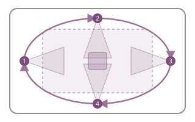
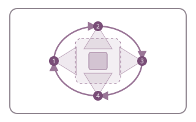
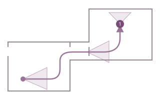
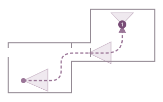

# Environment reference reels

An environment reel generates missing reference angles from a location image in one continuous journey. Save useful frames as asset images or select keyframes for later shots, rather than generating every angle separately and trying to reconcile different layouts.

Use **Scenes** to save a reviewed inspection set and authored staging constraints for drafting. Each shot then uses **Edit references** or **Copy...** to attach the pictures needed for generation. Compose uses those attachments and applicable accepted direction. Historical shot-level environment selections and their staging remain readable in request history.

Open a location image’s review/details dialog and choose **Create reel from this image** in its footer. This opens a fresh reel recipe with that image selected and preserves any earlier recipe. The same action is available for character and prop images. You can also choose **Reference reel** from the Assets tools’ **Create** selector.

## Choose useful coverage

These top-down diagrams illustrate movement, not a reconstructed floor plan. Lines and arrows show camera travel; shaded cones show viewing direction; numbered circles mark held views. Circuit view 4 returns to the starting position. Clockwise and counterclockwise are measured from above.

### Full set — 15 seconds

Use for a room, courtyard or other acting area. Travel around its outside while looking inward across the staging space and backgrounds. Keep enough distance for wide shooting positions, rather than orbiting tightly around one prop or turning outward from the centre. Full set is the default. Optionally name the acting area in Instructions; otherwise it is inferred from references and asset notes.

### Feature study — 15 seconds

Name a feature in Instructions. Complete a 360° orbit while keeping the whole feature and its immediate surroundings framed, holding four angles. This establishes that feature, not the entire environment.

### Walkthrough — 15 seconds

Use for a street, corridor or connected rooms. Describe the route and destination, for example: “From the gate, along the arcade, to the courtroom door.” Continuous progress reveals how the spaces join; the final hold provides a sharp destination view. The diagram is an example, not a prescribed route.

### Custom — 10 seconds

Describe the starting view, route and destination, including views to hold. Your Instructions determine the movement and pace. Aim to complete the intended reference coverage within this one reel.

## Example: the Noxian plaza

A wide entrance image shows the defendant’s podium, raised judicial bench, gate and fortress skyline. For **Full set**, maintain that broad scale and travel around the plaza’s edges, looking across the acting area. The podium is one landmark within the set, rather than something that fills every view.

For **Feature study**, name “the defendant’s podium and its steps” to establish the smaller area’s other faces and immediate backgrounds. For **Walkthrough**, name a connected route such as “from the gate, along the plaza’s edge, to the bench steps.”

## Using the library for scenes and shots

Prepare the environment once in **Scenes → Choose environment views**. Save a compact inspection set across stills and saved reel keyframes, together with authored staging constraints. **Save scene setup** does not attach generation inputs. Future drafts reuse this setup without another selection request. The scene strategy's assessment records what the inspected pictures support and what needs another view; it is not verified geometry.

After reviewing coverage, use **Edit references** or **Copy…** in Shots to choose the smaller set needed for generation. Choose **Environment** in the reference editor. Scene inspection views appear first as compact cards, with descriptions under **View notes**; browse all environment views for alternatives. **Assets** and **Shot frames** use the same editor, so a saved take frame can also be attached directly without exporting it to Assets. One or a few pictures usually suffice for a static shot. Each keyframe uses a picture slot and no reel slot, with its name, notes, timestamp and crop retained. Camera movement from the reel is not sent with these pictures. RefMod remains an explicit option in the editor, requires at least two frames and consumes a reel slot.

Compose uses attached references and applicable accepted direction without another environment selection request. Changing scene setup does not silently rewrite accepted direction or its historical evidence. Missing files and unkeyframed reels remain explainable through Assets and request history.

## References and Instructions

Select your clearest location image and any additional views of the same place. Crops, asset notes and reference guidance define recognizable features and physical relationships. Use the source composition when it suits the route; otherwise allow an opening appropriate to the coverage.

Unseen areas are newly designed by the video model, not a verified reconstruction. Additional references constrain them. All presets preserve stationary scenery and lighting, use clear camera routes and produce silent visual references. Review authored directions so they describe one coherent plan.

Requested duration is adjusted to the model’s frame grid. Shorter reels leave less time to travel and settle. Keep the area or route manageable within the 15-second limit, and review the resulting coverage before relying on it.

## Review and reuse

1. Review the composed prompt and use guidance, then generate the reel when ready.
2. Watch the entire reel. Check fixed landmark placement, connected passages and coverage of all intended sides without crossing scenery. A matching beginning and ending alone is insufficient.
3. Open **Manage keyframes** and choose **Suggest views** for AI assistance. It inspects a shortlist of distinct, relatively sharp frames, available original images and the reel's saved instructions. Add selection instructions when needed, such as “include the podium, judge's platform and reverse toward the gate.” Review the proposed names, notes and coverage warnings; edit or uncheck individual views. **Add selected views** preserves existing picks, crops and notes; **Replace picks with selected views** replaces the pending list. **Undo picks** restores the previous selection. Use **Save keyframes** to keep the changes. **More selection tools → Quick picks** offers a fast local fallback without AI labels. Individual frames can also be saved as independent asset images with their selected view name and notes.
4. Use those images or selected keyframes as shot references. Direct video references use only the beginning of a reel, up to the target shot’s length; that may omit most of a full circuit.
5. Correct use guidance to describe the environment the result actually establishes. Later shots choose their own camera movement, action and dialogue.

View names describe actual visible landmarks and facing directions, not guaranteed angles from the planned route. They and frame notes travel into shot references and Compose in both **Keyframes** and **RefMod** modes. Keyframes use individually numbered picture inputs; RefMod packs two to nine selected still views into one video-reference input and is built automatically as needed. Choose the useful views first, then the delivery mode. Neither mode requires exporting each frame as a separate asset image. Failed AI responses remain inspectable; **Try again / change model** opens a new request without overwriting picks.

Reels without saved viewpoints show **Needs keyframes** in the gallery and details. Select the badge to choose views; after saving it shows the keyframe count. This status describes viewpoint coverage, not whether the clip can be played or used as a direct video reference.

**Views → Automatic** lets AI choose enough complementary views for coverage, up to nine. A numbered limit is a ceiling, not a request to fill every slot. AI suggestions and local **Quick picks** share the same sharpness and diversity analysis; AI additionally interprets what each view shows. Selection notes focus on the suggested views and important coverage gaps. The full candidate contact sheet remains under **Request and response**. Saved responses keep their original wording; request a new suggestion to use updated guidance.

Saved clips and captured recipes remain unchanged when preset choices change. An unfinished recipe using a removed preset asks you to choose a replacement; its references, crops and authored prompts are retained.

## Direction and reference support

Shot direction separates dramatic purpose from proposed positions and camera placement. Scene drafting considers that purpose and the inspected environment pictures. Compose considers the accepted scene strategy, current neighbouring shots and the references attached to this setup. Historical **reference-supported staging** records claims against captured candidate identities, media hashes and crops, with supported, inferred, missing or conflicting status. A model's interpretation is evidence for review, not verified geometry. Camera recipes remain intended coverage, not proof of the layout.

Changing direction, strategy, references or crops can make this staging need review. Compose receives applicable direction and limitations, preserves the story's intent and qualifies unsupported spatial claims. Inspect conflicts or missing angles rather than asking an environment image to prove an arrangement it does not show. See [reviewable shot direction](shots.md#reviewable-direction).

Accepted drafting assessments also recheck their inspected pictures and environment guidance against Assets before Compose. Editing an inspected keyframe's crop or notes requires renewed staging/support review; adding unrelated viewpoints does not. The captured history remains intact. In drafting review, expand a claim to correct its text, support status or evidence, or remove it. A feature that cannot be confidently identified may be obscured or outside the supplied views; that alone does not justify adding or relocating it.
